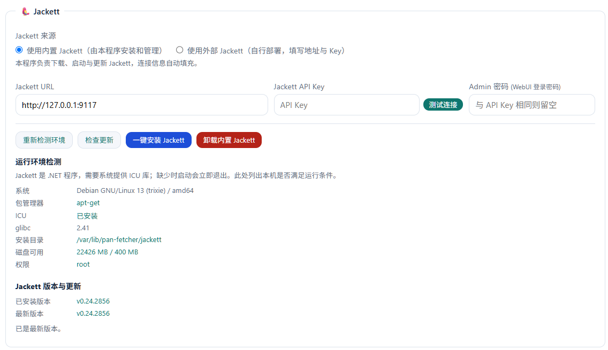
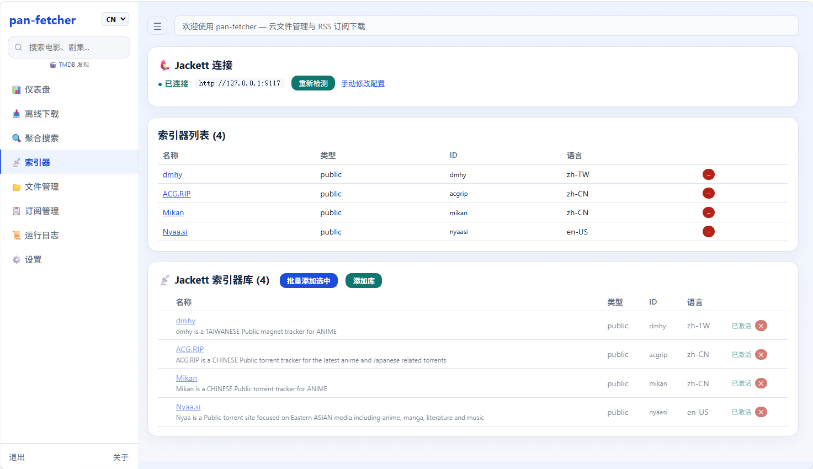
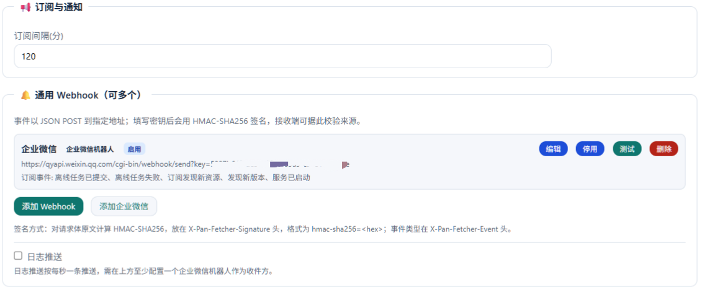

# pan-fetcher

<p align="center">
  <strong>115 网盘 · 聚合搜索 · RSS 自动订阅 · 离线下载 · 文件管理</strong>
</p>

<p align="center">
  <a href="https://github.com/lingeringdawn/pan-fetcher/releases"></a>
  <a href="https://github.com/lingeringdawn/pan-fetcher/blob/master/LICENSE"></a>
  <a href="https://go.dev"></a>
  <a href="https://github.com/lingeringdawn/pan-fetcher/pkgs/container/pan-fetcher"></a>
</p>

<p align="center"><strong>中文</strong> | <a href="#english">English</a></p>

---

自动追番 / 追剧工具。在数百个 BT 索引站里搜索资源，订阅后定时抓取新条目并自动推送 115 离线下载，全流程在 Web 面板完成。

所有网盘操作均通过 115 官方 API 进行。**仅支持 Linux。**

## ✨ 功能

### 🎬 TMDB 发现

按片名搜索电影与剧集，查看详情（海报、简介、评分、类型），一键带着片名跳到聚合搜索找资源。首页另有热门趋势。

### 🔍 聚合搜索

经 Jackett 同时检索你启用的索引器，结果合并去重后按标签自动分类：**字幕组、语言、来源、分辨率、编码、容器、季**，每类可单独筛选，也可按关键词二次过滤。

**默认过滤掉标题不含搜索词的条目。** 索引站匹配较宽松，简短片名（如 `TARI TARI`）常带出大量无关结果。过滤规则：

- 各搜索词须**按序、按出现次数**匹配 —— `TARI TARI` 是片名本身，只出现一次的 `TARI - 01` 会被剔除
- 忽略大小写与标点、折叠空白，因此 `TARI.TARI`、`TARI_TARI`、`TARITARI`、`TARI[TARI]` 均能命中
- 匹配须落在词首，避免搜索词在无关单词内部被误命中
- 中文/日文标题正常匹配

可在设置页关闭。

<p align="center"></p>

### 📡 Jackett 集成

搜索通过 Jackett 的 Torznab 协议完成，两种使用方式在设置页切换：

| 模式 | 行为 |
|------|------|
| **内置**（默认） | 本程序负责下载、启动、更新与卸载 Jackett |
| **外部** | 使用你自行部署的实例（本机或另一台机器），本程序不下载、不启动、不改动其文件 |

内置模式提供：

- **自动检测**本机实例并读取其配置（含 API Key），无需手工填写
- **运行环境检测**：发行版、glibc / musl、ICU 库、包管理器、root 权限、安装目录可写性、磁盘空间。缺依赖时可一键安装（支持 apt / dnf / yum / apk / pacman / zypper），安装后重新检测，不谎报成功
- **安装前预检**：环境不满足时不下载 50MB，直接给出原因与可粘贴的安装命令
- **版本检测与更新**：一键更新，先停止运行中的实例再整体替换，失败不影响现有安装
- **卸载**：默认保留索引器配置与 API Key，重装可复用

<p align="center"></p>

索引器库支持批量启用/停用、连接测试，搜索结果标注来源。

<p align="center"></p>

### 📋 RSS 订阅

定时抓取、去重、关键词过滤、缓存管理。

- **去重**按种子哈希记录，同一资源不会重复推送；缓存可在订阅页逐条查看与清理
- **关键词过滤**支持分组语法：`group:NEST language:简日内封`（同组内 `|` 表示或，跨组为且）
- **过滤词存在地址中**，编辑时正确回显，保存时同步改写
- 支持由聚合搜索直接生成订阅

<p align="center"></p>

### 📥 离线下载

磁力 / ed2k / http 链接批量提交，按状态分栏查看，支持任务清理。

<p align="center"></p>

### 📂 文件管理

115 网盘目录浏览、新建文件夹、重命名、移动、复制、删除。

<p align="center"></p>

### 📊 仪表盘

运行概览：推送统计、订阅状态、索引器数量、缓存条目、最近新增资源。

<p align="center"></p>

### 🔔 通知推送

所有通知目标集中在设置页的**一个列表**里，每条可单独订阅事件：

| 类型 | 行为 |
|------|------|
| **通用 Webhook** | 以 JSON POST 事件；填写密钥后附带 **HMAC-SHA256 签名** |
| **企业微信机器人** | 以企业微信的 markdown 格式发送 |

可订阅的事件：

| 事件 | 触发时机 |
|------|---------|
| `task.submitted` | 离线任务已提交 |
| `task.failed` | 离线任务失败 |
| `rss.found` | 订阅发现新资源 |
| `update.available` | 发现新版本 |
| `server.started` | 服务已启动 |
| `log` | 运行日志（每秒一条，限流） |

请求格式：

```
POST <你的地址>
Content-Type: application/json
X-Pan-Fetcher-Event: rss.found
X-Pan-Fetcher-Signature: hmac-sha256=<hex>
X-Pan-Fetcher-Signature-Algorithm: hmac-sha256
X-Pan-Fetcher-Delivery: <投递 id>

{"type":"rss.found","time":"2026-10-15T17:20:12+08:00",
 "title":"RSS 新资源","body":"## RSS 新资源...",
 "data":{"sub":"侦探已死","count":2,"names":["..."]}}
```

签名对**请求体原文**计算 HMAC-SHA256。`X-Pan-Fetcher-Delivery` 在重试时保持不变，接收端可据此去重。投递仅对网络错误与 5xx 重试一次，4xx 不重试；投递异步执行，接收端故障不影响下载。

接收端校验示例：

```python
import hashlib, hmac

SECRET = b"your-secret"

def verify(body: bytes, signature_header: str) -> bool:
    want = "hmac-sha256=" + hmac.new(SECRET, body, hashlib.sha256).hexdigest()
    return hmac.compare_digest(want, signature_header)
```

<p align="center"></p>

### 📜 运行日志

实时日志，最新在前，自动刷新。

<p align="center"></p>

### ⚙️ 面板与部署

- **一键自更新**：面板内检查并更新，升级后配置（订阅过滤词、Jackett 连接、通知目标）保持不变
- 中英双语、HTTPS、密码登录（自更新后密码不会丢失）
- Docker 一键部署、Linux systemd 安装脚本、预编译二进制（amd64 / arm64）

<p align="center"></p>

## 🚀 快速开始

> **仅支持 Linux。** pan-fetcher 依赖 Linux 的进程与文件语义（自更新、子进程分离、Jackett 安装），不支持 Windows / macOS。

### Docker（推荐）

```bash
curl -fsSL https://raw.githubusercontent.com/lingeringdawn/pan-fetcher/master/scripts/docker-setup.sh | bash
```

打开 `http://localhost:8115`，进入设置页完成配置。

仓库提供的 `docker-compose.yml` 会同时启动 **pan-fetcher 与 Jackett** 两个服务，并共享 Jackett 配置目录（因此 API Key 自动读取，无需手工填写）。数据保存在 `./data`。

也可直接使用镜像：

| 来源 | 镜像 |
|------|------|
| Docker Hub | `lingeringdawn/pan-fetcher:latest` |
| GHCR | `ghcr.io/lingeringdawn/pan-fetcher:latest` |

### Linux 一键脚本

```bash
curl -fsSL https://raw.githubusercontent.com/lingeringdawn/pan-fetcher/master/scripts/install-release.sh | sudo bash
```

安装为 systemd 服务，二进制位于 `/opt/pan-fetcher/bin`，数据位于 `/var/lib/pan-fetcher`。

```bash
install-release.sh install     # 安装或更新（默认）
install-release.sh update      # 同上
install-release.sh uninstall   # 卸载，保留配置与数据
install-release.sh purge       # 卸载并删除配置与数据
```

### 预编译二进制

从 [Releases](https://github.com/lingeringdawn/pan-fetcher/releases) 下载对应架构：

| 架构 | 文件 |
|------|------|
| Linux amd64 | `pan-fetcher-vX.Y.Z-linux-amd64.tar.gz` |
| Linux arm64 | `pan-fetcher-vX.Y.Z-linux-arm64.tar.gz` |

### 从源码编译

需要 Go 1.25：

```bash
git clone https://github.com/lingeringdawn/pan-fetcher.git
cd pan-fetcher
go build -ldflags="-s -w" -o pan-fetcher .
./pan-fetcher server
```

## 🖥️ 页面

| 页面 | 路由 | 说明 |
|------|------|------|
| 仪表盘 | `/` | 运行概览、最近新增资源 |
| 离线下载 | `/tasks` | 批量提交、任务管理 |
| 聚合搜索 | `/search` | 多索引器搜索、标签筛选 |
| 索引器 | `/indexers` | 索引器库、启用管理、连接测试 |
| 文件管理 | `/fs` | 115 网盘浏览与操作 |
| 订阅管理 | `/subs` | RSS 增删改、过滤词、缓存管理 |
| 运行日志 | `/log` | 实时日志 |
| 设置 | `/settings` | 登录、代理、通知、Jackett、自更新 |
| TMDB 发现 | `/discover` | 影视搜索、详情、一键搜资源 |
| 关于 | `/about` | 版本、作者与致谢 |

## ⌨️ CLI

除 Web 面板外，也可在命令行直接操作。

```bash
# 服务
pan-fetcher server                       # 启动 Web 面板
pan-fetcher magnet --link "magnet:..."   # 添加离线任务

# 网盘文件操作
pan-fetcher fs pwd                       # 显示当前目录
pan-fetcher fs ls [path]                 # 列出目录
pan-fetcher fs stat <path>               # 查看条目信息
pan-fetcher fs mkdir <path>              # 新建文件夹
pan-fetcher fs rename <path> <新名>      # 重命名
pan-fetcher fs mv <src...> <目标目录>    # 移动
pan-fetcher fs cp <src...> <目标目录>    # 复制
pan-fetcher fs rm <path...>              # 删除
pan-fetcher fs flatten <dir>             # 展平单层目录
pan-fetcher fs search-mv <搜索根> <关键词> <目标目录>   # 按关键词搜索并移动
```

`fs` 子命令支持 `--json` 输出，以及 `--cwd`、`--page-size`、`--list-cache-ttl` 等通用参数。

## 🔧 配置

```toml
# config.toml
[server]
port = 8115
# domain = "pan.example.com"           # 域名访问
# cert_file = "/certs/fullchain.pem"   # HTTPS 证书
# key_file = "/certs/privkey.pem"

[proxy]
http = "http://127.0.0.1:7890"         # HTTP 代理（访问 Jackett 等）
```

> 登录凭据、通知目标、Jackett 连接、订阅过滤词等均在 Web 设置页管理，保存在数据目录，无需手改配置文件。

## 🛠️ 技术栈

Go 1.25 · SQLite（WAL） · 单体 `html/template`（零前端依赖） · [elevengo](https://github.com/Nahuimi/elevengo) 115 API · Torznab

## 👤 作者

**lingeringdawn** — [www8ld.com](https://www8ld.com/)

## 🙏 致谢

- [zhifengle/rss2cloud](https://github.com/zhifengle/rss2cloud) — 项目原型
- [Jackett](https://github.com/Jackett/Jackett) — 索引引擎与 Torznab API
- [Nahuimi/elevengo](https://github.com/Nahuimi/elevengo) — 115 API 库

## 📄 许可证

[MIT](LICENSE)

---

## English

<p align="center"><a href="#">中文</a> | <strong>English</strong></p>

An automated anime / TV downloader for 115 cloud storage. Search across hundreds of BT indexers, subscribe to RSS feeds, and push new releases to 115 offline downloads — all from a web panel.

Every cloud operation goes through 115's official API. **Linux only.**

### Features

#### 🎬 TMDB Discover

Search movies and TV shows, view details (poster, overview, rating, genres), and jump straight into aggregated search. Trending titles on the home page.

#### 🔍 Aggregated Search

Query all your enabled indexers through Jackett at once. Results are merged, deduplicated, and classified by tag — **fansub group, language, source, resolution, codec, container, season** — each filterable on its own, plus a keyword filter.

**Results whose title does not contain the search terms are filtered out by default.** Indexers match loosely, so a short title such as `TARI TARI` returns a long tail of unrelated releases. The rules:

- Every term must appear, **in order and as many times as written** — `TARI TARI` is the title itself, so a single-occurrence `TARI - 01` is rejected
- Case and punctuation are ignored and whitespace collapsed, so `TARI.TARI`, `TARI_TARI`, `TARITARI` and `TARI[TARI]` all match
- Matches must start at a word boundary, so a term is not found inside an unrelated word
- CJK titles match normally

Can be turned off in Settings.

#### 📡 Jackett Integration

Search runs over Jackett's Torznab API. Two modes, switchable in Settings:

| Mode | Behaviour |
|------|-----------|
| **Built-in** (default) | This program downloads, starts, updates and uninstalls Jackett |
| **External** | Point at your own instance (on this host or another); nothing is downloaded, started or modified |

Built-in mode provides:

- **Auto-detection** of a local instance, including its API key — no manual entry
- **Host environment check**: distro, glibc/musl, ICU libraries, package manager, root privileges, install-dir writability, disk space. Missing dependencies can be installed in one click (apt / dnf / yum / apk / pacman / zypper), and the environment is re-checked afterwards so success is never faked
- **Pre-flight check**: an unsuitable host is reported before a 50 MB download, with a paste-ready install command
- **Version check and update**, stopping the running instance first and replacing the tree wholesale — a failed download leaves the working install untouched
- **Uninstall**, keeping indexer configuration and the API key by default

<p align="center"></p>

The indexer catalog supports batch enable/disable and connection tests; results are labelled with their source.

<p align="center"></p>

#### 📋 RSS Subscriptions

Scheduled fetching, deduplication, keyword filtering and cache management.

- Deduplication is keyed on torrent hashes, so the same release is never pushed twice; the cache is browsable and clearable per subscription
- Keyword filters support grouped syntax: `group:NEST language:简日内封` (OR within a group, AND across groups)
- The filter is stored in the feed URL, echoed back correctly when editing, and rewritten on save
- Subscriptions can be created directly from aggregated search

#### 📥 Offline Downloads

Submit magnet / ed2k / http links in bulk, view by status, clear finished tasks.

#### 📂 File Manager

Browse and manage 115 cloud storage: create folders, rename, move, copy, delete.

#### 📊 Dashboard

Overview of pushes, subscriptions, indexer count, cache entries and recently added releases.

#### 🔔 Notifications

Every destination lives in **one list** in Settings; each entry subscribes to events independently:

| Type | Behaviour |
|------|-----------|
| **Generic webhook** | POSTs the event as JSON, signed with **HMAC-SHA256** when a secret is set |
| **WeCom bot** | Sends WeChat Work's markdown format |

Subscribable events: `task.submitted`, `task.failed`, `rss.found`, `update.available`, `server.started`, `log` (throttled to one per second).

Request format:

```
POST <your-url>
Content-Type: application/json
X-Pan-Fetcher-Event: rss.found
X-Pan-Fetcher-Signature: hmac-sha256=<hex>
X-Pan-Fetcher-Signature-Algorithm: hmac-sha256
X-Pan-Fetcher-Delivery: <delivery-id>

{"type":"rss.found","time":"2026-10-15T17:20:12+08:00",
 "title":"RSS 新资源","body":"## RSS 新资源...",
 "data":{"sub":"...","count":2,"names":["..."]}}
```

The signature is HMAC-SHA256 over the **raw request body**. `X-Pan-Fetcher-Delivery` stays the same across retries so a receiver can deduplicate. Delivery retries once on transport errors and 5xx, never on 4xx, and runs asynchronously so a failing receiver cannot block downloads.

Verifying on the receiving end:

```python
import hashlib, hmac

SECRET = b"your-secret"

def verify(body: bytes, signature_header: str) -> bool:
    want = "hmac-sha256=" + hmac.new(SECRET, body, hashlib.sha256).hexdigest()
    return hmac.compare_digest(want, signature_header)
```

<p align="center"></p>

#### 📜 Runtime Log

Live log, newest first, auto-refreshing.

#### ⚙️ Panel & Deployment

- **In-app self-update**; settings (subscription filters, Jackett connection, notification targets) survive the upgrade
- Bilingual (CN/EN), HTTPS, password login — and the password survives a self-update
- Docker one-liner, Linux systemd installer, prebuilt binaries (amd64 / arm64)

### Quick Start

> **Linux only.** pan-fetcher relies on Linux process and filesystem semantics (in-place self-update, detached child processes, Jackett install). Windows and macOS are not supported.

**Docker (recommended):**

```bash
curl -fsSL https://raw.githubusercontent.com/lingeringdawn/pan-fetcher/master/scripts/docker-setup.sh | bash
```

Open `http://localhost:8115`. It starts **both pan-fetcher and Jackett**, sharing Jackett's config directory so the API key is picked up automatically. Data lives in `./data`.

Images: `lingeringdawn/pan-fetcher:latest` (Docker Hub) or `ghcr.io/lingeringdawn/pan-fetcher:latest` (GHCR).

**Linux one-liner:**

```bash
curl -fsSL https://raw.githubusercontent.com/lingeringdawn/pan-fetcher/master/scripts/install-release.sh | sudo bash
```

Installs as a systemd service. Binary in `/opt/pan-fetcher/bin`, data in `/var/lib/pan-fetcher`. Subcommands: `install` (default), `update`, `uninstall` (keeps data), `purge` (removes everything).

**Prebuilt binaries:** [GitHub Releases](https://github.com/lingeringdawn/pan-fetcher/releases) — `linux-amd64` and `linux-arm64`.

**From source** (Go 1.25):

```bash
git clone https://github.com/lingeringdawn/pan-fetcher.git
cd pan-fetcher
go build -ldflags="-s -w" -o pan-fetcher .
./pan-fetcher server
```

### Pages

| Page | Route | Description |
|------|-------|-------------|
| Dashboard | `/` | Overview, recently added releases |
| Offline Downloads | `/tasks` | Bulk submit, task management |
| Aggregated Search | `/search` | Multi-indexer search, tag filters |
| Indexers | `/indexers` | Indexer catalog, enable/disable, connection test |
| File Manager | `/fs` | Browse and manage 115 cloud storage |
| Subscriptions | `/subs` | RSS CRUD, filters, cache management |
| Runtime Log | `/log` | Live log |
| Settings | `/settings` | Login, proxy, notifications, Jackett, self-update |
| TMDB Discover | `/discover` | Movie & TV search, details, one-click search |
| About | `/about` | Version, author, credits |

### CLI

```bash
# Service
pan-fetcher server                       # Start the web panel
pan-fetcher magnet --link "magnet:..."   # Add an offline task

# Cloud filesystem
pan-fetcher fs pwd                       # Print working directory
pan-fetcher fs ls [path]                 # List a directory
pan-fetcher fs stat <path>               # Show entry info
pan-fetcher fs mkdir <path>              # Create a folder
pan-fetcher fs rename <path> <new-name>  # Rename
pan-fetcher fs mv <src...> <target-dir>  # Move
pan-fetcher fs cp <src...> <target-dir>  # Copy
pan-fetcher fs rm <path...>              # Delete
pan-fetcher fs flatten <dir>             # Flatten a single-level directory
pan-fetcher fs search-mv <root> <keyword> <target-dir>   # Search and move by keyword
```

`fs` subcommands accept `--json`, plus `--cwd`, `--page-size` and `--list-cache-ttl`.

### Configuration

```toml
# config.toml
[server]
port = 8115
# domain = "pan.example.com"
# cert_file = "/certs/fullchain.pem"
# key_file = "/certs/privkey.pem"

[proxy]
http = "http://127.0.0.1:7890"
```

> Credentials, notification targets, the Jackett connection and subscription filters are all managed from the web panel and stored in the data directory — no manual file editing needed.

### Tech Stack

Go 1.25 · SQLite (WAL) · single `html/template` (zero frontend deps) · [elevengo](https://github.com/Nahuimi/elevengo) · Torznab

### Author

**lingeringdawn** — [www8ld.com](https://www8ld.com/)

### Credits

Based on [zhifengle/rss2cloud](https://github.com/zhifengle/rss2cloud). Search is served by [Jackett](https://github.com/Jackett/Jackett) over its Torznab API.

### License

[MIT](LICENSE)
